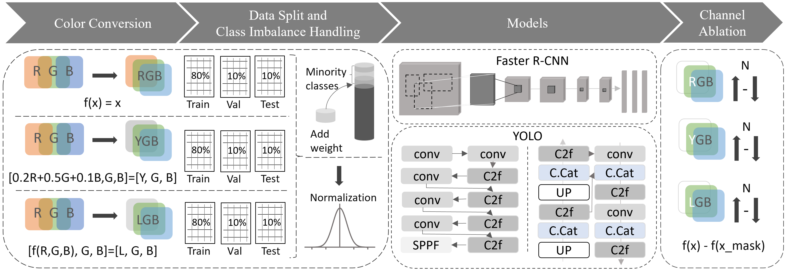

# LGB-journal

---

## Overview

Object detectors almost always take RGB images as input. This work asks whether the red channel, which is highly correlated with the green and blue channels, can be replaced by a perceptual brightness signal.

We propose **LGB**, a three-channel input in which the red channel is replaced by the lightness **L** of the perceptually uniform **OKLab** color space, and compare it with **RGB** and with the previously published **YGB** (red replaced by YCbCr luminance **Y**). Each color representation is evaluated on two satellite datasets with four detectors (YOLOv8n, YOLO12n, YOLO26n, and Faster R-CNN), giving 24 trained detectors. Channel masking ablation and paired t-tests examine how much each detector depends on each channel.

<p align="center">
    
  <br>
  <em>Fig. 1: Pipeline: color conversion, data split, class imbalance handling, detector training, and channel masking ablation.</em>
</p>

---

## The Core Idea

RGB has two structural problems for CNN-based detection:

1. **High inter-channel correlation.** The R, G, and B channels share redundant luminance information (pairwise correlations of 0.78 to 0.98), so the network must implicitly resolve this redundancy.
2. **Perceptual non-uniformity.** Equal Euclidean distances in RGB do not correspond to equal perceived color differences.

LGB replaces the red channel with an explicit, perceptually uniform brightness signal:

| Color Space | Channel 1 | Channel 2 | Channel 3 | Key Property |
|-------------|-----------|-----------|-----------|--------------|
| **RGB** | Red | Green | Blue | Baseline (sensor-native) |
| **YGB** | Luminance Y (YCbCr) | Green | Blue | Linear brightness |
| **LGB** | Lightness L (OKLab) | Green | Blue | Perceptually uniform brightness |

### Color conversion

**YGB:** `Y = 0.299·R + 0.587·G + 0.114·B`

**LGB:** L from OKLab, computed in four stages:
1. **Gamma linearization** of sRGB to linear light
2. **LMS transform** to cone-response space (matrix M1)
3. **Cube-root compression** (approximates the nonlinear brightness response)
4. **Lightness extraction** `L = 0.2104542·l' + 0.7936177·m' − 0.0040720·s'`

---

## Experimental Setup

- **Datasets:** SIMD (5,000 images, 15 classes; [Kaggle](https://www.kaggle.com/datasets/akhileshnegi/satellite-imagery-of-multiple-vehicles/data)) and SkySeaLand, SSL (1,307 images, 4 classes;(https://www.kaggle.com/dsv/13673736)]]. Each is split 80/10/10 into train/validation/test.
- **YOLO models** (YOLOv8n, YOLO12n, YOLO26n; Ultralytics): trained from scratch, standard Ultralytics loss and default augmentation, pixel values scaled to [0,1].
- **Faster R-CNN** (ResNet-50 + FPN v2; torchvision): fine-tuned from COCO weights with class-weighted softmax cross-entropy (square-root inverse frequency) and flip-only augmentation. To avoid favoring RGB, all three color representations use the same color-neutral start: channel-independent normalization (mean 0.449, std 0.226), first-layer filters averaged over the input channels, and backbone BatchNorm statistics re-estimated on the training images.
- **Metrics:** mAP@50-95 (primary), mAP@50, precision, and recall. YOLO and Faster R-CNN differ in pretraining, loss weighting, augmentation, and metric computation, so color spaces are compared within each detector.
- Each configuration was trained once (seed 42).

---

## Key Results

### mAP@50-95 (best per row in bold)

| Dataset | Model | RGB | YGB | LGB |
|---------|-------|-----|-----|-----|
| SIMD | YOLOv8n | 0.6199 | 0.6092 | **0.6286** |
| SIMD | YOLO12n | **0.6197** | 0.5734 | 0.5646 |
| SIMD | YOLO26n | **0.6151** | 0.5990 | 0.5948 |
| SIMD | Faster R-CNN | 0.6558 | **0.6623** | 0.6577 |
| SSL | YOLOv8n | 0.4252 | 0.4399 | **0.4442** |
| SSL | YOLO12n | 0.3500 | 0.3476 | **0.3848** |
| SSL | YOLO26n | **0.3257** | 0.2816 | 0.2903 |
| SSL | Faster R-CNN | 0.5488 | 0.5572 | **0.5636** |

LGB achieves the highest mAP@50-95 in 4 of the 8 dataset-architecture combinations, RGB in 3, and YGB in 1. LGB is a competitive alternative, not a universally superior replacement; the full tables (mAP@50, precision, recall) are in the paper.

### Channel masking ablation (mean detection confidence, LGB models)

| Dataset | Model | Baseline | L masked | G masked | B masked |
|---------|-------|----------|----------|----------|----------|
| SIMD | YOLOv8n | 0.7000 | 0.0015 | 0.4985 | 0.4884 |
| SIMD | Faster R-CNN | 0.9062 | 0.5379 | 0.2043 | 0.6026 |
| SSL | YOLOv8n | 0.5267 | 0.0006 | 0.1817 | 0.1890 |
| SSL | Faster R-CNN | 0.8653 | 0.7008 | 0.6977 | 0.3170 |

The YOLO models depend strongly on the L channel, whereas Faster R-CNN depends considerably less on L, and its most influential channel differs between the datasets. Paired t-tests (R in RGB vs. L in LGB) are significant in all comparisons (p < 0.00001). These are responses to a zero-filling intervention, not direct measurements of the information in each channel.

---

## Repository Structure

```
.
├── matlab/               # color conversion (RGB -> YGB, RGB -> LGB) and dataset building
├── YAML/                 # dataset configs (data.yaml) for the YOLO runs
├── YOLO/                 # YOLO training notebooks
├── F-RCNN/               # Faster R-CNN training, channel ablation, and paired t-test notebooks
├── runs/                 # YOLO outputs (weights not included)
├── runs_frcnn/           # Faster R-CNN outputs, default ImageNet normalization (weights not included)
├── runs_frcnn_neutral/   # Faster R-CNN outputs, color-neutral start (weights not included)
├── figures/              # pipeline.png, color_comparison.png
└── README.md
```

## How to Reproduce

1. Download SIMD and SSL and convert the images to RGB, YGB, and LGB with the scripts in `matlab/`.
2. Train the YOLO models with the notebooks in `YOLO/` (dataset configs in `YAML/`).
3. Train Faster R-CNN and run the channel ablation and paired t-tests with the notebooks in `F-RCNN/`.

## Dependencies

```bash
pip install ultralytics==8.4.38 torch torchvision torchmetrics numpy opencv-python scipy
```

- Python 3.13+, PyTorch 2.7+, MATLAB (color conversion)

---

## References

- Ottosson, B. (2020). *A perceptual color space for image processing.* OKLab.
- Tkalcic, M. & Tasic, J.F. (2003). *Colour spaces: perceptual, historical and applicational background.* IEEE.
- Idris, N. & Mashaly, M. (2024). *Beyond RGB: Channel fusion for improved cross-domain car detection.* ICCA 2024.
- Ren, S., He, K., Girshick, R. & Sun, J. (2015). *Faster R-CNN: Towards real-time object detection with region proposal networks.* NeurIPS.
- Jocher, G., Qiu, J., & Chaurasia, A. (2023). *Ultralytics YOLO.* https://github.com/ultralytics/ultralytics
- Haroon, M. et al. (2020). *Multi-sized object detection using spaceborne optical imagery.* IEEE JSTARS.
